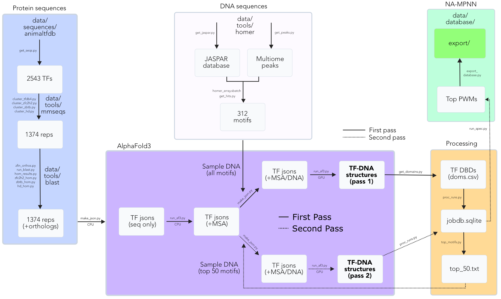

# Proteome-scale inference of transcription factor binding motifs from predicted protein-DNA structures

This project is under development and not yet stable.

Developed and maintained by the Royer group at CZ Biohub SF. Maintainer: [@biovino2](https://github.com/biovino2).

We predict the DNA-binding specificity (PPMs) of zebrafish transcription factors by folding each TF
with candidate DNA sequences in AlphaFold3, then reading out binding preferences from the predicted
protein-DNA structures with NA-MPNN and clustering them into consensus motifs.

### Installation

Requires Python 3.10+ and a SLURM cluster for job submission.

```bash
python -m pip install -e ./
python -m pip install pre-commit
pre-commit install
```

Set your paths, SLURM resources, and notification settings in
`src/af3tfm/config.local.yaml` (gitignored), overriding the defaults in
[config.yaml](src/af3tfm/config.yaml).

### External tools

Install separately (versions used in the paper):

- Structure prediction: [AlphaFold3](https://github.com/google-deepmind/alphafold3) 3.0.1
  with its sequence databases and November 2024 model parameters (GPU required;
  request parameters from Google DeepMind).
- Specificity prediction: [NA-MPNN](https://github.com/baker-laboratory/NA-MPNN)
  commit `835974f3`, checkpoint `s_70114.pt`.
- Sequence processing: [InterProScan](https://github.com/ebi-pf-team/interproscan) 5.73-104.0,
  [MMseqs2](https://github.com/soedinglab/MMseqs2) 18.8cc5c,
  [MAFFT](https://mafft.cbrc.jp/alignment/software/) 7.520, and
  [BLAST+](https://ftp.ncbi.nlm.nih.gov/blast/executables/blast+/LATEST/) 2.16.0.
- Motif analysis: [HOMER](http://homer.ucsd.edu/homer/introduction/install.html) 5.1

Optional downstream analyses use separate environments:
[chromVAR and related R tools](data/tools/chromvar/README.md) (R 4.4.1 / Bioconductor 3.20)
and [CellOracle](data/tools/celloracle/README.md) (0.18.0; gimmemotifs 0.17.0).

### Data sources

Please cite the resources you use and follow their terms of use.

| Resource | Version | Used for | Citation |
|---|---|---|---|
| [AnimalTFDB](https://guolab.wchscu.cn/AnimalTFDB4/) | 4.0 | Zebrafish and human TF lists and family labels | Shen et al., *Nucleic Acids Res.* (2023) |
| [Ensembl](https://www.ensembl.org) | REST API (unpinned) | Zebrafish and human TF protein sequences | Harrison et al., *Nucleic Acids Res.* (2024) |
| [CisBP](https://cisbp.ccbr.utoronto.ca/) | 3.10 | Benchmark PWMs; CisBP and hybrid GRN motif databases | Weirauch et al., *Cell* (2014) |
| [JASPAR](https://jaspar.elixir.no/) | 2024 CORE vertebrates (redundant) | Ortholog ground-truth motifs, HOMER known-motif database, null distribution | Rauluseviciute et al., *Nucleic Acids Res.* (2024) |
| [Zebrahub-Multiome](https://zebrahub.org/) | 2025 release | snATAC peaks, Leiden peak clusters, SEACells metacells | Kim et al., *bioRxiv* (2025) |
| [ZFIN](https://zfin.org/) orthology | Downloaded July 2026 | Curated zebrafish-human orthologs (benchmark) | Bradford et al., *Genetics* (2022) |
| [RefSeq](https://www.ncbi.nlm.nih.gov/refseq/) human proteins | Downloaded Apr. 2026 | BLAST ortholog search | O'Leary et al., *Nucleic Acids Res.* (2016) |
| [Pfam](https://www.ebi.ac.uk/interpro/entry/pfam/) | 37.2 | DNA-binding domain annotation; homeodomain HMM (PF00046) | Mistry et al., *Nucleic Acids Res.* (2021) |
| Zebrafish genome | danRer11 (GRCz11) | Peak coordinates and motif scanning | Genome Reference Consortium |

### Workflow and analysis



See [scripts/](scripts/) for pipeline commands and [notebooks/](notebooks/) for Jupytext analyses.

### ZebraMotif database export

Run from the repository root using existing research predictions:

```bash
python data/database/export_data.py                  # build and package
python data/database/export_data.py --from-existing  # package existing data
python data/database/export_data.py --check          # verify the export
```

See [data/database/](data/database/README.md) for release configuration, outputs,
and Zenodo packaging. Run with `--help` for additional options.

### AlphaFold3 outputs

Structure predictions, confidence metrics, and any data derived from them are AlphaFold3 Output and
are provided under and subject to the
[AlphaFold 3 Output Terms of Use](https://github.com/google-deepmind/alphafold3/blob/main/OUTPUT_TERMS_OF_USE.md).
They are for non-commercial use only and are not intended for clinical use. The MIT license of this
repository applies to the code only. The required notice is also provided at
[Legally Binding Terms of Use.txt](Legally%20Binding%20Terms%20of%20Use.txt).

The `DNA-Binding` column in each of the following domain tables contains
AF3-derived flags and is subject to those Output Terms:

- [AnimalTFDB representatives](data/sequences/animaltfdb/tfdb4_rep_doms.csv)
- [AnimalTFDB validation set](data/sequences/animaltfdb/tfdb4_val_doms.csv)
- [CisBP](data/sequences/cisbp/cisbp_doms.csv)
- [SELEX candidates](data/sequences/selex/selex_candidates_doms.csv)
- [SELEX](data/sequences/selex/selex_doms.csv)

Reference domain annotations in these tables retain their providers' terms.

### Citation

- Iovino, B. et al. *Proteome-scale inference of transcription factor binding motifs
  from predicted protein-DNA structures*. bioRxiv (2026).
  [Preprint](https://doi.org/10.64898/2026.11.18.767614)
- ZebraMotif dataset, version 0.1 (2026). [Zenodo record](https://zenodo.org/records/23380219)

If you use this work, please also cite AlphaFold3:

> Abramson, J. et al. Accurate structure prediction of biomolecular interactions with AlphaFold 3.
> *Nature* (2024).

### Reporting Security Issues

Report vulnerabilities to [security@biohub.org](mailto:security@biohub.org);
see [SECURITY.md](SECURITY.md).

### Code of Conduct

This project follows the [Contributor Covenant Code of Conduct](CODE_OF_CONDUCT.md).

### License

This code is released under the MIT license. See [LICENSE](LICENSE).
